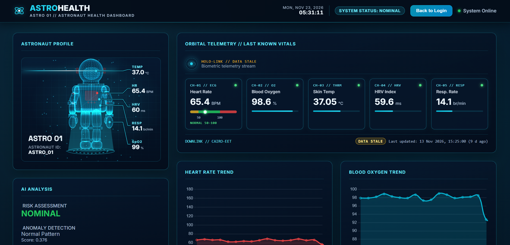
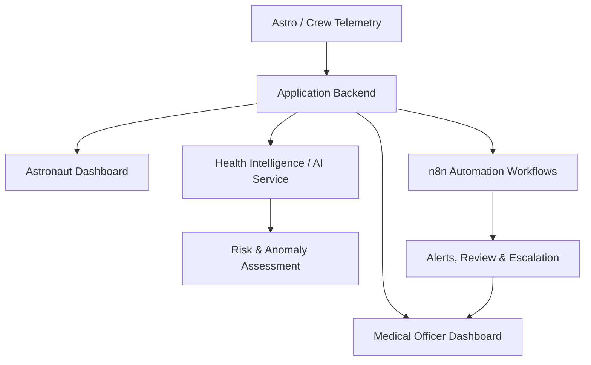

# ASTROHEALTH
### Orbital Crew Health Monitoring & Medical Operations Platform

**A mission-control experience for astronaut telemetry, AI-assisted health assessment, and medical incident review.**

---

## Overview

ASTROHEALTH is an astronaut health-monitoring and medical-operations project built around a connected mission workflow. It brings astronaut-facing telemetry, medical-officer dashboards, AI-assisted summaries, and incident follow-up into one interface.

The platform is designed to demonstrate how health signals and operational events can move from monitoring to review and escalation. The screenshots below show the current dark, mission-control interface.

## Interface Gallery

### 01 — Medical Officer Console

The main console brings crew selection, system status, live vital-sign cards, and the medical officer's monitoring workspace together.

### 02 — Crew Profile & Live Telemetry

A crew-member profile is paired with the latest available biometric readings, including heart rate, blood oxygen, skin temperature, HRV, and respiratory rate. Telemetry freshness is explicitly surfaced in the interface.

### 03 — AI Health Analysis

The analysis view presents the current risk assessment, anomaly status, contributing factors, and recent heart-rate trend context. It is an operational decision-support view, not a medical diagnosis.

### 04 — Astronaut Dashboard

The astronaut-facing view provides a focused health snapshot with vital-sign indicators and trend charts.

### 05 — AI Health Assistant

The assistant interface supports health-related questions within the available astronaut context and displays structured responses with scope/status information.

### 06 — Medical Incidents Overview

Medical officers can review incident counts, review priorities, engine-event status, and the current medical-review state.

### 07 — Incident Review & Escalation

The incident review panel surfaces escalation state, reminder information, AI-triage availability, and acknowledgement actions.

---

## Core Capabilities

- **Crew health monitoring:** astronaut profiles and vital-sign telemetry views.
- **Medical operations dashboard:** consolidated monitoring, historical context, and incident review.
- **AI-assisted assessment:** risk and anomaly summaries designed to support human review.
- **AI health assistant:** conversational access to the available astronaut health context.
- **Incident workflow:** review status, acknowledgement, and escalation visibility.
- **Telemetry freshness indicators:** clear distinction between current system status and the timestamp of the last received data.

## Automation & Workflow Layer

The project includes n8n workflow automation for health-alert orchestration, AI-assisted health support, incident review/acknowledgement, and escalation follow-up. Workflow exports and supporting project assets are maintained in the repository.

## Architecture

At a high level, ASTROHEALTH connects these layers:

## Important Demo Note

ASTROHEALTH is a software demonstration and decision-support project. Displayed readings may be simulated, delayed, or stale; always check the last-updated timestamp and telemetry status. AI-generated content is not a diagnosis and must not replace qualified medical judgement.

## Repository Contents

Explore the repository for the application source, health-intelligence components, workflow exports, and supporting documentation. Refer to the relevant folder-level README files for setup and implementation details.

## License

This project is distributed under the MIT License. See [`LICENSE`](LICENSE) for details.
