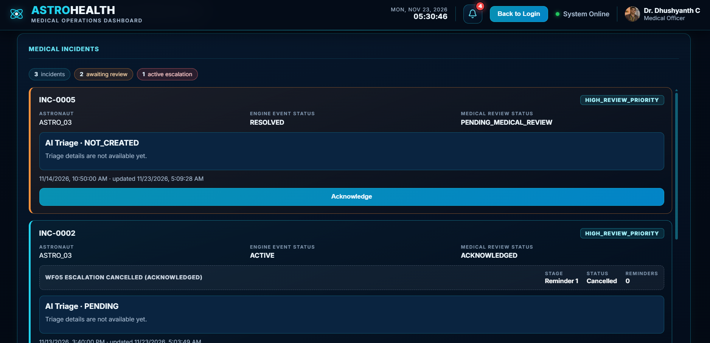
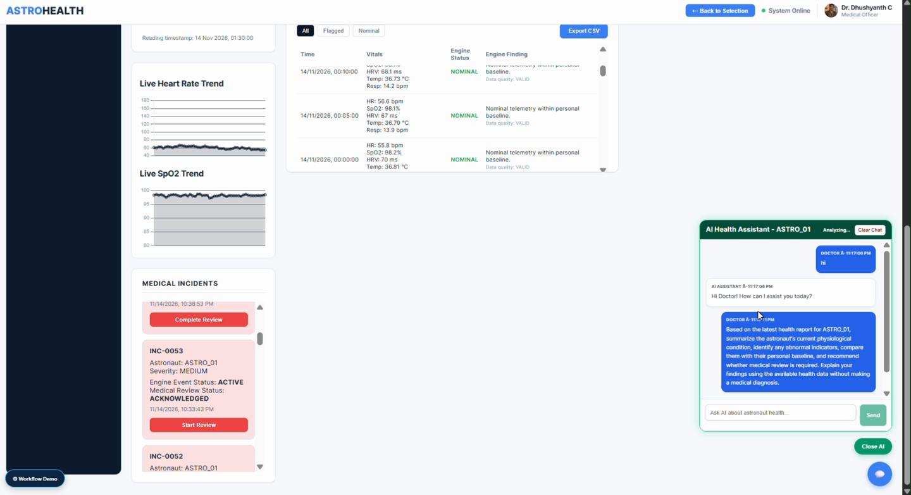
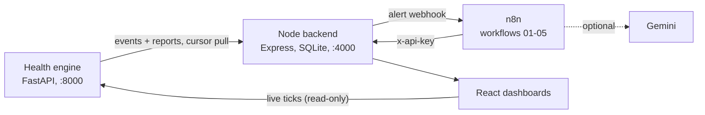

<p align="center"></p>

<h1 align="center">ASTROHEALTH</h1>
<p align="center"><b>Astronaut health monitoring: a Python intelligence engine, a Node incident backend, n8n automation and mission-control dashboards.</b></p>

<p align="center">
  
  
  
  
  
</p>

<p align="center">
  <a href="#what-it-does">Overview</a> ·
  <a href="#architecture">Architecture</a> ·
  <a href="#automation">Automation</a> ·
  <a href="#quick-start">Quick start</a> ·
  <a href="#configuration">Configuration</a> ·
  <a href="#testing">Testing</a> ·
  <a href="#ملخص-بالعربية">عربي</a>
</p>

> **Research prototype on synthetic telemetry.** ASTROHEALTH flags deviations from each astronaut's own baseline for human review. It does not diagnose, prescribe or replace a medical officer, and it must not be used with real patient data. See [Limitations](docs/LIMITATIONS.md) and [Security](docs/SECURITY.md).

<p align="center"><a href="docs/assets/demo.mp4"><b>▶ Watch the demo recording</b></a></p>

## At a glance

| | |
|---|---|
| **Problem** | Crew health data is noisy and every person is different; fixed thresholds either miss drift or flood reviewers. |
| **Approach** | Per-astronaut circadian and sleep-aware baselines, sensor-quality checks and a hybrid statistical + Isolation-Forest score that must persist before it raises an incident. |
| **Human in the loop** | Every incident goes to a medical officer; the AI writes a review brief, never a diagnosis. |
| **Stack** | Python 3.13 / FastAPI · Node.js 22 / Express / SQLite · n8n · React 19 / Vite |

## What it does

1. **Engine** (`astronaut-health-intelligence/`) builds a personal circadian and sleep-aware baseline per astronaut, validates sensor data (no imputation, flatline and gap detection) and raises incidents only when a hybrid statistical and Isolation-Forest score persists. Every event carries the vitals involved, observed vs expected values, and a `needs_human_review` flag.
2. **Backend** (`backend/`) pulls the engine's event feed with a replay-safe cursor, stores incidents, triage jobs and escalation timers in SQLite, and owns every medical-review state transition (`ACKNOWLEDGE`, `START_REVIEW`, `COMPLETE_REVIEW`).
3. **n8n workflows** (`automation/`) validate alerts, produce evidence-grounded AI briefs (Gemini, optional) and advance escalation timers. The AI writes a review brief, never a diagnosis.
4. **Dashboards** (`frontend/`) give astronauts a live status view and medical officers analytics, history, incidents and the workflow center.

| | |
|---|---|
|  |  |
|  |  |

## Architecture



The backend is the source of truth for incidents and review state; n8n orchestrates but never owns state. The JSON contract between engine and backend is `schema_version: 1.0` ([JSON_CONTRACT](astronaut-health-intelligence/docs/JSON_CONTRACT.md)).

## Automation

| # | Workflow | Trigger | Purpose |
|---|---|---|---|
| 01 | Health Alert Orchestrator | Webhook `health-alert` | Validates `HEALTH_REVIEW_REQUIRED` events, upserts the incident, returns a correlated acknowledgement |
| 02 | AI Health Assistant | Webhook `health-assistant` | Evidence-grounded explanation from backend report and events |
| 03 | Incident Review & Acknowledgment | Webhook `incident-review` | Applies `ACKNOWLEDGE` / `START_REVIEW` / `COMPLETE_REVIEW` and verifies persistence |
| 04 | Mission Connection Monitor | Manual | Read-only status snapshot |
| 05 | Smart Triage & Escalation Watcher | Every 60 s | AI triage brief per due job, advances escalation timers |

Exports are **inactive** and contain no credentials. Point them at your backend with one command and import the result:

```bash
node scripts/configure-workflows.js https://api.example.com   # writes automation/workflows.configured/
```

Details and contracts: [automation/README.md](automation/README.md), [docs/AUTOMATION.md](docs/AUTOMATION.md).

## Quick start

Open <http://localhost:5173> after all three services are running. Demo accounts (`admin`, `doctor`, `astro01`..`astro04`) are created on first start; their password is `SEED_PASSWORD`, or `123456` if unset (demo only).

<details open>
<summary><b>Windows (launcher)</b></summary>

```bat
:: 1. engine environment (once)
cd astronaut-health-intelligence
py -m venv .venv && .venv\Scripts\pip install -r requirements.txt
cd ..\backend && npm install && copy .env.example .env   :: set SESSION_SECRET and API_KEY
cd ..\frontend && npm install
cd .. && START_ASTROHEALTH.bat
```
</details>

<details>
<summary><b>Linux / macOS</b></summary>

```bash
# engine
cd astronaut-health-intelligence && python3 -m venv .venv && . .venv/bin/activate
pip install -r requirements-tested-py313.txt fastapi==0.162.4
HEALTH_SIM_AUTOSTART=1 uvicorn api_server:app --host 127.0.0.1 --port 8000

# backend (new terminal)
cd backend && npm install && cp .env.example .env     # set SESSION_SECRET and API_KEY
HEALTH_ENGINE_URL=http://127.0.0.1:8000 node server.js

# frontend (new terminal)
cd frontend && npm install && cp .env.example .env && npm run dev
```
</details>

## Configuration

| Where | Variable | Purpose |
|---|---|---|
| backend | `SESSION_SECRET` **(required)** | Session signing; the server exits without it |
| backend | `API_KEY` **(required)** | `x-api-key` for `/api/v1/*`; must match the n8n credential |
| backend | `FRONTEND_ORIGIN`, `HEALTH_ENGINE_URL`, `DB_PATH`, `SEED_PASSWORD` | Origins, engine URL, SQLite path, demo password |
| backend | `HEALTH_ALERT_WEBHOOK_URL`, `HEALTH_ASSISTANT_WEBHOOK_URL`, `INCIDENT_REVIEW_WEBHOOK_URL` | n8n production webhooks |
| frontend | `VITE_API_URL`, `VITE_ENGINE_URL` | Backend / engine URLs, compiled into the build |

Full templates: [`backend/.env.example`](backend/.env.example), [`frontend/.env.example`](frontend/.env.example).

## Deploy on a VPS

See **[docs/DEPLOYMENT.md](docs/DEPLOYMENT.md)**: environment variables, reverse proxy ([deploy/nginx.conf.example](deploy/nginx.conf.example)), n8n wiring, optional `docker compose`, and a hardening checklist. Read it before exposing anything to the internet.

## Testing

```bash
cd astronaut-health-intelligence
python tests/test_engine.py   # 23 tests
python tests/test_live.py     # 16 tests
```

Verified status and everything that was **not** tested: [docs/FINAL_VERIFICATION.md](docs/FINAL_VERIFICATION.md) and [CHANGELOG.md](CHANGELOG.md).

## Repository layout

```
astronaut-health-intelligence/  Python engine (active runtime: hybrid-v2.0, schema 1.0), tests, integration/node
reference/engine-v4.1.1/        newer engine handoff, kept for comparison, not imported (see docs/VERSIONS.md)
backend/                        Express API, SQLite, engine sync worker, incident / triage / escalation routes
frontend/                       React + Vite dashboards
automation/                     n8n workflow exports (01-05) and setup guide
ml_service/                     legacy Prophet / Random-Forest service, not required by the engine-based stack
deploy/  scripts/               nginx example, workflow URL configurator
docs/                           architecture, automation, security, limitations, verification
```

## Engine versions

The active engine is `hybrid-v2.0` (API advertises 2.1.0). The `reference/engine-v4.1.1` handoff (`hybrid-v2.1`) is **not** wired in; promoting it requires compatibility tests and a coordinated JSON-contract review ([docs/VERSIONS.md](docs/VERSIONS.md)).

## ملخص بالعربية

**ASTROHEALTH** نظام تجريبي لمراقبة صحة رواد الفضاء على بيانات تخليقية. المحرك (Python) يبني خط أساس شخصي لكل رائد ويرصد الانحرافات المستمرة، والباك (Node) يخزّن الحوادث ويدير حالات المراجعة الطبية، وسير عمل n8n يجهّز الملخصات ويتابع مؤقتات التصعيد، ولوحات React تعرض الحالة للرائد وللطبيب. الذكاء الاصطناعي يكتب ملخص مراجعة فقط ولا يشخّص، والقرار دائمًا للطبيب المختص. **لا تستخدمه مع بيانات مرضى حقيقية.**

## Team & credits

Team names and profile links: _add here_ (see [docs/PUBLICATION_CHECKLIST.md](docs/PUBLICATION_CHECKLIST.md)).
Documentation index: [docs/README.md](docs/README.md).

## License

MIT. See [LICENSE](LICENSE).
