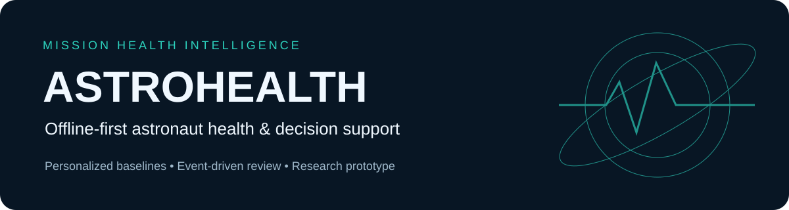
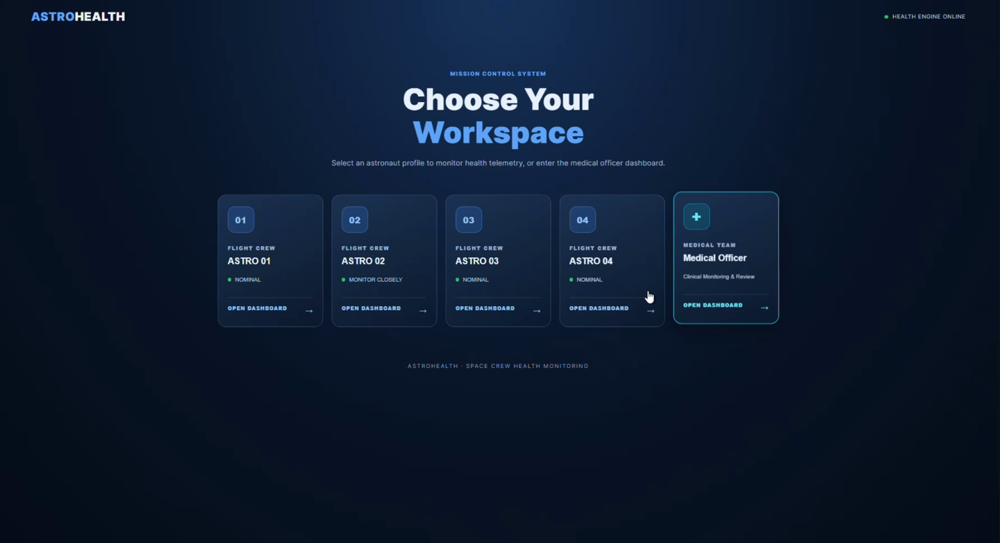
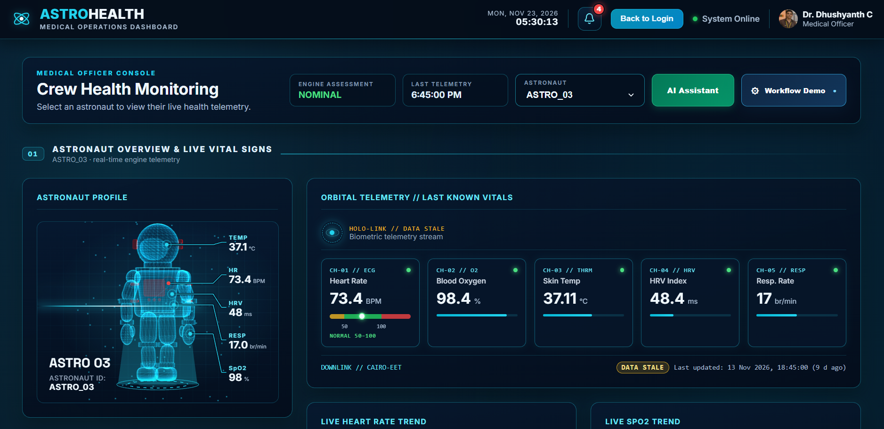
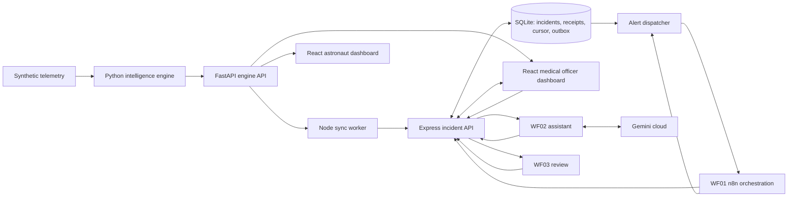
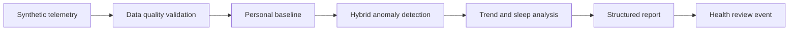
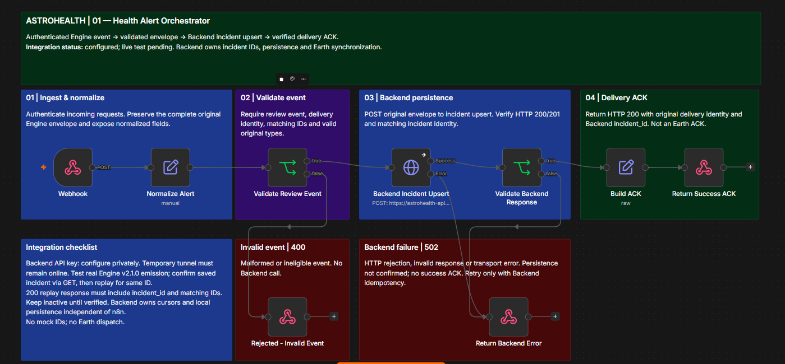
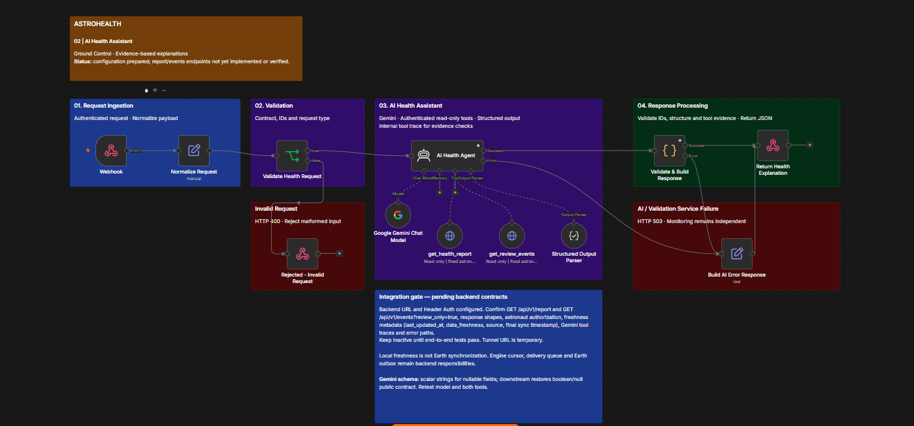
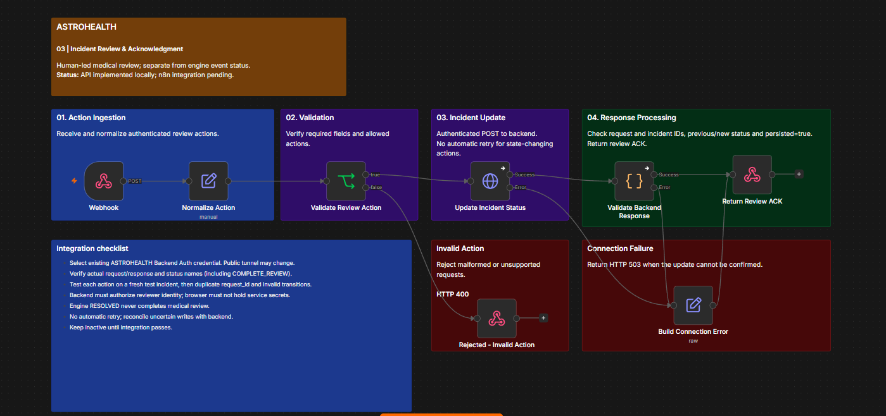
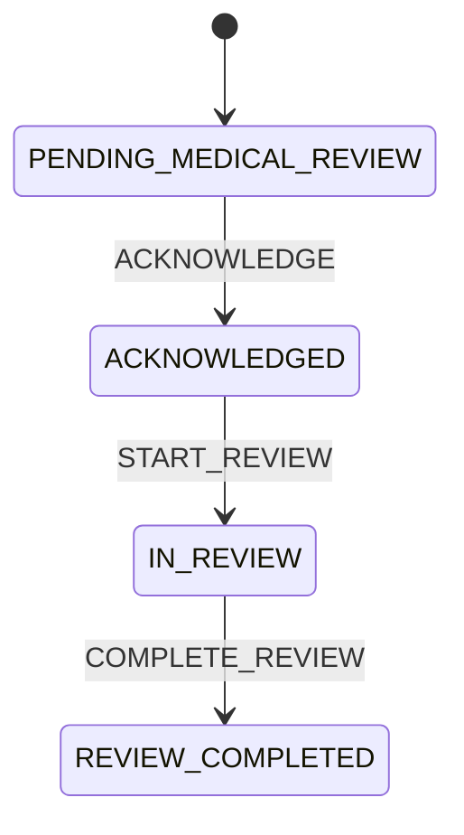
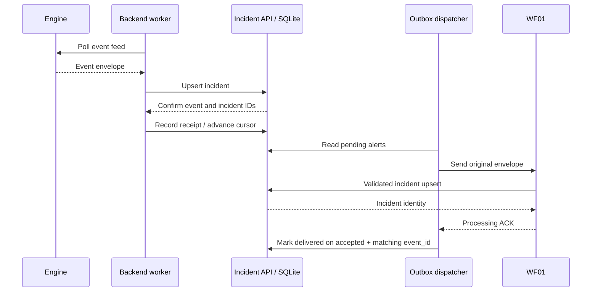

<div align="center">



# ASTROHEALTH

### Personalized Health Intelligence for Communication-Constrained Space Missions

A research prototype combining personalized physiological analysis, persistent event processing, evidence-grounded AI automation and human-led medical review.

      

[Demo](#demo) · [Architecture](#system-architecture) · [Engine](#health-intelligence-engine) · [Automation](#event-driven-ai-automation) · [Verification](#verification-and-scientific-evaluation) · [Quick start](#run-locally)

NASA Space Apps Challenge project · Synthetic telemetry · Research prototype, not a medical device or NASA-approved system

</div>

## Demo

[](docs/assets/demo.mp4)

**[Watch the 56-second demo (MP4)](docs/assets/demo.mp4)** — the supplied recording shows workspace selection, astronaut vitals and trends, mission control, incident review and the AI assistant. A hosted video URL can replace this link at publication; no external URL has been invented.

## Dashboard showcase

Real frames extracted from the supplied demo, not generated mockups. The recording demonstrates the UI; it is not an independently repeated end-to-end test.

| Astronaut workspace | Medical officer workspace |
| --- | --- |
|  |  |
| Live vital measurements and trend charts for a selected astronaut. | Mission control: astronaut selection and current health findings. |
|  |  |
| Incident cards and medical review actions. | Assistant response in the medical officer interface. |

## The challenge

Communication with Earth can be constrained during space missions. Astronauts have individual physiological patterns, and a deviation from a personal baseline may warrant attention even when a generic threshold is not crossed. Continuous local analysis and structured review can help a crew and medical officers maintain situational awareness.

## Our approach

ASTROHEALTH separates **measurement, interpretation, operational coordination and medical decisions**. The Python engine produces structured findings from synthetic telemetry; the Node backend persists events and coordinates delivery; n8n validates and orchestrates workflows; Gemini explains retrieved findings; medical officers own review decisions. The optional cloud assistant is not the source of anomaly detection.

| Engineering differentiator | Why it matters |
| --- | --- |
| Personal baselines + hybrid detection | Compare each astronaut against their own physiology, combining statistical and ML signals. |
| Event and emission identity | Distinguish a persistent physiological event from individual emitted updates. |
| Persistent cursor and receipts | Track progress across engine feed polling and restarts. |
| SQLite incidents + alert outbox | Retain local incident state and retry unconfirmed alert delivery. |
| Evidence-grounded explanations | Retrieve selected-astronaut reports/events and validate structured references. |
| Human review lifecycle | Acknowledgment, review and completion remain distinct from physiological resolution. |

## System architecture



[Architecture details](docs/ARCHITECTURE.md) · [API contract](docs/API_REFERENCE.md). WF04 is a manual read-only status snapshot. The current UI also reads engine ticks directly; the backend owns incident state. No separate onboard/ground database or completed Earth synchronization is asserted.

## Health Intelligence Engine



The integrated **hybrid-v2.0 / schema 1.0** engine calibrates for 48 hours, models personal and contextual baselines, applies statistical deviation scoring and Isolation Forest, and analyzes sustained changes and sleep. Data-quality checks protect the analysis from invalid measurements. Four astronaut streams are exposed in the current runtime.

| Signal | Unit | Role |
| --- | --- | --- |
| Heart rate | bpm | Cardiovascular rate relative to personal baseline |
| Heart rate variability | ms | Beat-to-beat variability indicator |
| Oxygen saturation | % | Oxygenation trend |
| Peripheral skin temperature | °C | Peripheral thermal signal, not core temperature |
| Respiratory rate | breaths/min | Breathing-rate trend |

Reports use `NOMINAL`, `MONITOR_CLOSELY`, `REVIEW_REQUIRED`, `INSUFFICIENT_DATA`; severity ranges from `NONE` through `LOW_DEVIATION`, `MODERATE_DEVIATION`, `HIGH_REVIEW_PRIORITY`. An anomaly score is engine-defined deviation, **not disease probability**. Integrated sustained trend detection covers a subset of signals; the separately retained v4.1.1 / hybrid-v2.1 expands drift detection to all five. See [engine versions](docs/VERSIONS.md) and [scientific foundation](docs/SCIENTIFIC_FOUNDATION.md).

## Event-driven AI automation

n8n coordinates operational events, validated delivery and human-in-the-loop review. It does not own the physiological model or authoritative incident database.

| Workflow | Purpose | Engineering features |
| --- | --- | --- |
| [WF01](automation/workflows/01-health-alert-orchestrator.json) | Health Alert Orchestrator | Envelope validation, identity checks, backend upsert, processing ACK |
| [WF02](automation/workflows/02-ai-health-assistant.json) | AI Health Assistant | Gemini, two retrieval tools, structured parser, evidence-reference and context checks |
| [WF03](automation/workflows/03-incident-review.json) | Incident Review | Action and identity validation, transition and persistence verification |
| [WF04](automation/workflows/04-sync-monitoring.json) | Optional Sync Monitoring | Manual, read-only status snapshot and explicit error paths |

### WF01 — From a health event to a confirmed incident



Normalize → validate → backend incident upsert → verify response → delivery ACK. Preserves the original engine envelope, supports inner/outer `needs_human_review` and `created_at`/`timestamp`, and checks event/astronaut identities. A successful ACK confirms processing, not Earth communication.

### WF02 — Evidence-grounded health assistant



`get_health_report` retrieves current analyzed findings; `get_review_events` retrieves historical review events. Gemini uses a structured output parser, then downstream validation checks request identity, selected astronaut and references against tool traces. Missing data and failures are represented explicitly. Prompt restrictions are not authentication or authorization; backend enforcement is still required. The assistant explains findings, never diagnoses or prescribes.

```json
{"schema_version":"1.0","request_id":"DEMO-001","astronaut_id":"ASTRO_01","request_type":"HEALTH_BRIEFING","question":""}
```

The request above is an illustrative sanitized contract example, not a recorded execution. [Workflow contracts and setup](docs/AUTOMATION.md).

### WF03 — Medical review lifecycle





The backend owns state and persistence. WF03 checks request, incident, astronaut, reviewer, previous/new status and persisted confirmation. Engine `RESOLVED` does not establish clinical recovery or complete medical review.

### WF04 — Optional connection monitor

Manual GET of the backend prototype connection snapshot; validates response and returns IDLE, PENDING, PAUSED or explicit failure. It does not dispatch to Earth or establish synchronization. The supplied workflow screenshots retain historical sticky notes; current status is in [verification](docs/FINAL_VERIFICATION.md).

## Event delivery and reliability



The worker polls every five seconds; first bootstrap starts at the current sequence, not historical backfill. The outbox attempts delivery periodically when configured. Its actual ACK check is `accepted === true` plus matching `event_id`; WF01 validates additional identity fields. No exactly-once or atomic end-to-end guarantee is claimed. Local engine, backend, SQLite and retryable delivery are foundations for offline-first monitoring, not a validated blackout recovery system. Remote n8n and Gemini require connectivity.

## Verification and scientific evaluation

| Evidence | Result | Scope |
| --- | --- | --- |
| Integrated engine audit | 35/39 passed; four timezone failures | hybrid-v2.0, previous audit log |
| Local engine smoke | FastAPI startup, health and astronaut list verified | hybrid-v2.0, current revision |
| Independent engine handoff | 48 Python, 7 Node, 19 HTTP shim tests passed | v4.1.1 author report; not integrated runtime |
| Independent blind synthetic evaluation | 4/4 injected events detected; 11 review false alarms / 15 astronaut-days | v4.1.1, synthetic only |

The false-alarm burden is a material limitation. Synthetic tests do not establish clinical accuracy. Backend/frontend runtime and n8n execution are not independently verified in this revision. [Technical verification](docs/FINAL_VERIFICATION.md) · [Independent report](reference/engine-v4.1.1/TEST_REPORT_FINAL.md) · [Evaluation](reference/engine-v4.1.1/outputs/evaluation_report.md).

## Technology and repository map

| Directory | Contents |
| --- | --- |
| `astronaut-health-intelligence/` | Active Python / FastAPI engine, tests, reports |
| `backend/` | Express, SQLite, worker, API and fixtures |
| `frontend/` | React / Vite dashboards |
| `automation/workflows/` | Four sanitized n8n exports |
| `reference/engine-v4.1.1/` | Independent newer engine; not default runtime |
| `docs/` | Technical documentation, visuals, verification |

## Run locally

**Verification status:** 35/39 integrated Python tests passed in the audit environment; four timestamp-related failures remain. The engine starts locally; backend/frontend dependencies were unavailable in the offline cache. See [current verification](docs/FINAL_VERIFICATION.md). See [verification](docs/TESTING.md).

Use three terminals. Python 3.13 and Node 22 are the audit environment; the supplied original pinned requirements are retained, and an alternative local manifest is included for compatibility testing. Node 22.12+ is required by Vite 7. See [setup and demo](docs/DEMO.md).

```bash
cd astronaut-health-intelligence
python -m venv .venv
# Linux/macOS: source .venv/bin/activate
# Windows PowerShell: .venv\Scripts\Activate.ps1
python -m pip install -r requirements-local.txt
# Linux/macOS
HEALTH_SIM_AUTOSTART=1 python -m uvicorn api_server:app --host 127.0.0.1 --port 8000
```

Windows PowerShell: set `$env:HEALTH_SIM_AUTOSTART="1"` before the same uvicorn command.

```bash
cd backend
# copy .env.example to .env; set a random API_KEY
npm ci
npm start
```

```bash
cd frontend
npm ci
npm run dev
```

Open http://localhost:5173. Engine API: http://127.0.0.1:8000/docs. Backend: http://localhost:4000/api/openapi.json. The Windows launcher uses these same directories after dependencies are installed.


## Technical documentation and roadmap

[Architecture](docs/ARCHITECTURE.md) · [API](docs/API_REFERENCE.md) · [Automation](docs/AUTOMATION.md) · [Security](docs/SECURITY.md) · [Limitations](docs/LIMITATIONS.md) · [Demo](docs/DEMO.md) · [Final verification](docs/FINAL_VERIFICATION.md) · [Changelog](docs/FINAL_CHANGELOG.md) · [Publication](docs/PUBLISHING.md)

Before deployment: resolve timestamp compatibility, verify the legacy generator configuration, run full-stack and n8n integration, enforce authentication and reviewer authorization, and test disconnected operation/recovery. Future mission architecture and v4.1.1 integration require separate validation. No sync dashboard or offline Gemini is claimed.

## Team

| Contributor | Scope |
| --- | --- |
| Omar Ayman | AI automation, n8n, evidence-grounded assistant, review workflow, integration validation |
| Mustafa | Python intelligence engine, synthetic telemetry, anomaly detection, scientific evaluation |
| Abdelrahman | Node backend, SQLite, system integration and current functional frontend implementation |
| Ahmed | Frontend interface development and UI/UX design |

Additional teammates contributed research and presentation preparation; names not supplied.

## Safety and license

Research prototype using synthetic data. Anomaly scores are not disease probabilities. No diagnosis, treatment recommendations, clinical clearance or autonomous medical decisions. Engine resolution does not mean medical review is complete. See [limitations](docs/LIMITATIONS.md) and [license](LICENSE).
