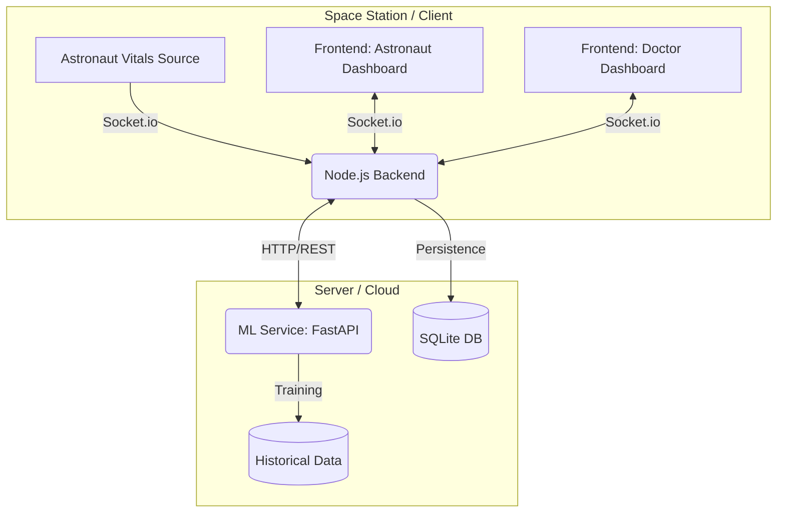

# Astronaut Health Monitoring System

   

> **Astronaut Health Monitoring System** is a comprehensive 3-tier architecture designed to safeguard astronaut health in deep space missions. It combines a **React** frontend for mission control dashboards, a **Node.js** backend for real-time data orchestration, and a **Python/FastAPI** machine learning service that detects anomalies and predicts health risks in real-time.

---

## System Architecture



## Key Features

*    **Real-time Telemetry**: Sub-second latency monitoring of heart rate, oxygen saturation, and stress levels.
*   **AI Risk Assessment**: 
    *   **Random Forest**: Classifies health risk (Low/High/Critical).
    *   **Isolation Forest**: Detects anomalies in vital signs.
*   **Predictive Forecasting**: Uses **Prophet** to forecast heart rate trends for proactive intervention.
*   **Emergency Comms**: Integrated secure chat between astronauts and medical officers.
*   **Interactive Dashboards**: 
    *   **Astronaut View**: Simplified live status and chat.
    *   **Doctor View**: Detailed analytics, historical trends, and alerts.
*   **Dockerized**: Fully containerized microservices architecture for easy deployment.

## n8n Automation Layer

ASTROHEALTH includes an n8n automation layer that connects health-engine events with backend incident handling, AI-assisted medical review, and mission-connection monitoring. Workflow exports are stored in [`automation/workflows/`](automation/workflows/).

| Workflow | Purpose | Trigger |
| --- | --- | --- |
| **01 — Health Alert Orchestrator** | Validates incoming `HEALTH_REVIEW_REQUIRED` events, registers the incident with the backend, and returns a correlated acknowledgement. | Webhook |
| **02 — AI Health Assistant** | Builds a structured, evidence-aware response using the health report and review-event APIs; Gemini is optional and requires credentials. | Webhook |
| **03 — Incident Review & Acknowledgment** | Processes medical-officer actions (`ACKNOWLEDGE`, `START_REVIEW`, `COMPLETE_REVIEW`) and verifies the persisted state transition. | Webhook |
| **04 — Mission Connection Monitor** | Reads a mission-connection snapshot; it does not own dispatch, retries, or acknowledgements. | Manual |
| **05 — Smart Triage & Escalation Watcher** | Polls backend triage jobs, creates a structured AI brief grounded in supplied evidence, saves it through the backend, and advances due escalation timers. | Every 60 seconds |

**WF05 safety boundary:** the AI produces a review brief, not a diagnosis or treatment recommendation. The backend validates evidence references and owns durable job/escalation state. The current workflow records escalation progression; it does not itself deliver a doctor-facing notification.

See [Automation setup and API contracts](docs/AUTOMATION.md) before importing or activating workflows. All workflow exports should remain inactive until credentials, webhook authentication, URLs, and end-to-end behavior have been verified in the target n8n instance.

---

## Tech Stack

*   **Frontend**: React, Vite, Recharts, TailwindCSS.
*   **Backend**: Node.js, Express, Socket.io.
*   **ML Service**: Python, FastAPI, Scikit-learn, Prophet, Pandas.
*   **Database**: SQLite (for chat/logs), In-memory (for real-time vitals).

## Quick Start

### Prerequisites
*   Docker & Docker Compose

### Run with Docker (Recommended)

1.  **Clone the repository**
    ```bash
    git clone https://github.com/chinmai-sd-123/astronaut_health_monitoring.git
    cd astronaut_health_monitoring
    ```

2.  **Build and Start Services**
    ```bash
    docker-compose up --build
    ```
    *Note: The ML service will take a moment to train models on the first run.*

3.  **Access the Application**
    *   **Frontend**: [http://localhost:5173](http://localhost:5173)
    *   **Backend API**: [http://localhost:4000](http://localhost:4000)
    *   **ML Docs**: [http://localhost:8000/docs](http://localhost:8000/docs)

## Manual Development Setup

If you prefer running services individually:

### 1. ML Service (Python)
```bash
cd ml_service
# Create venv (optional but recommended)
python -m venv venv
source venv/bin/activate # or venv\Scripts\activate on Windows
pip install -r requirements.txt
python train_models.py  # Train initial models
uvicorn main:app --reload --port 8000
```

### 2. Backend (Node.js)
```bash
cd backend
npm install
node seed.js # Optional: Seed initial data
node server.js
```

### 3. Frontend (React)
```bash
cd frontend
npm install
npm run dev
```

## Project Structure

```
/health_monitoring
├── /ml_service     # Python FastAPI (Model training & Inference)
├── /backend        # Node.js Express (Socket.io & API)
├── /frontend       # React Vite (Dashboards)
└── docker-compose.yml
```

## Contributing

Contributions are welcome! Please fork the repository and submit a pull request.


