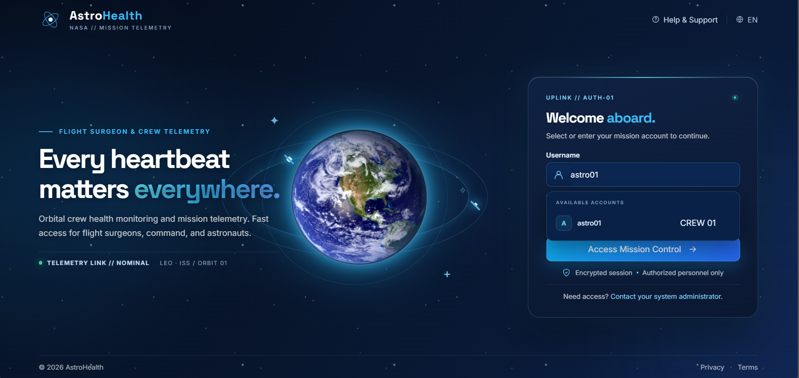
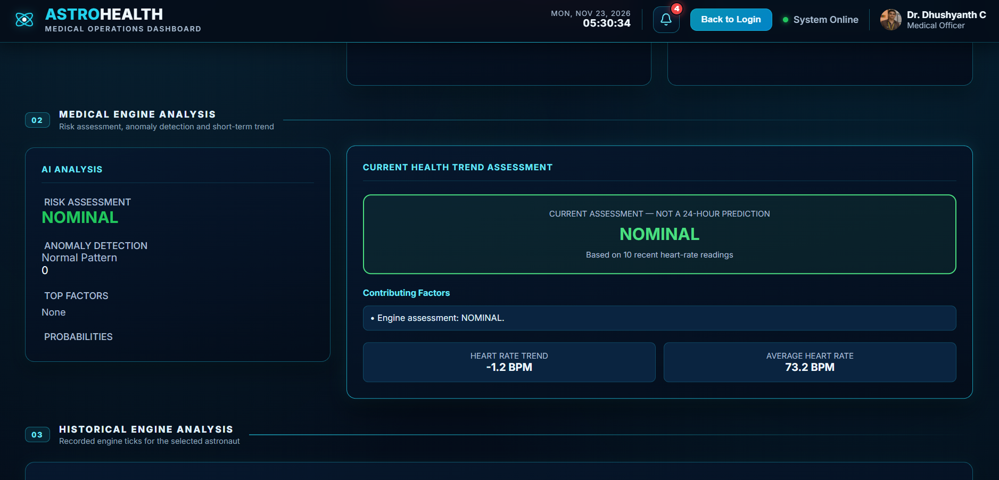
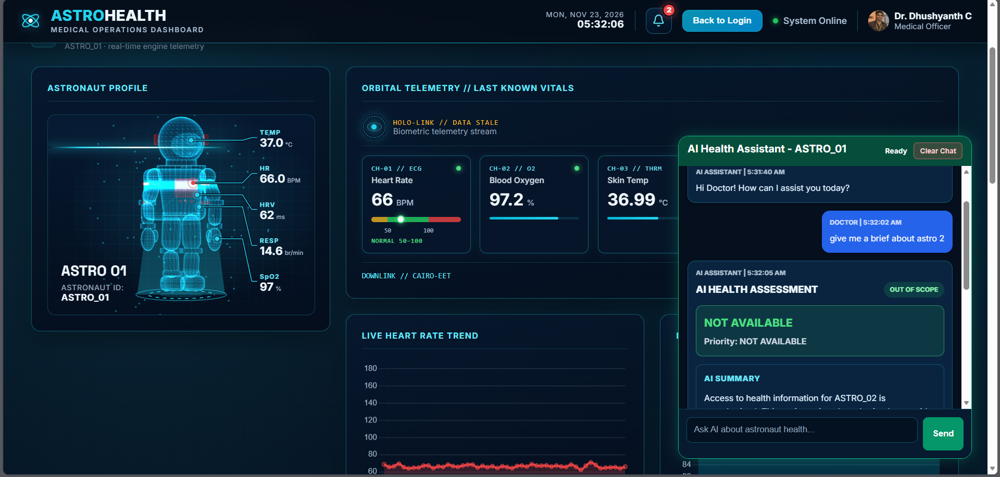
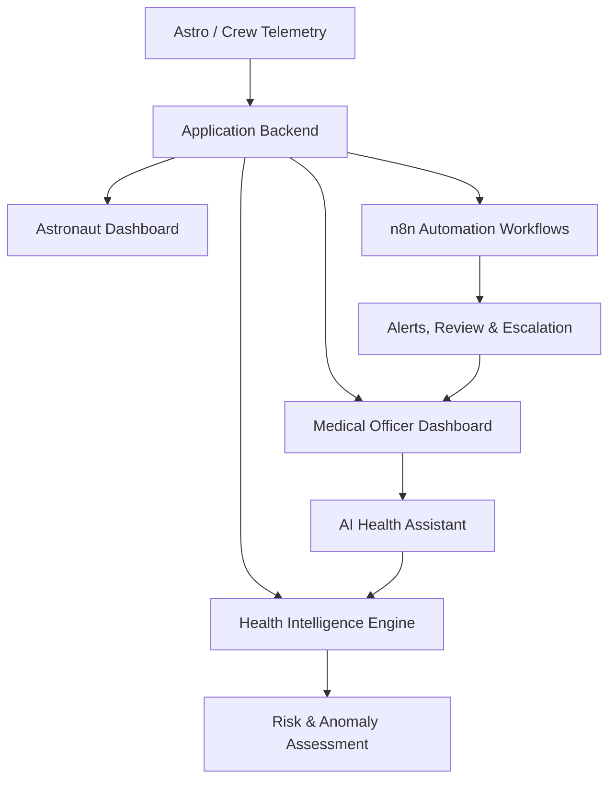

# ASTROHEALTH
### Orbital Crew Health Monitoring & Medical Operations Platform

**A mission-control experience for astronaut telemetry, AI-assisted health assessment, and medical incident review.**

---

## Overview

ASTROHEALTH is an astronaut health-monitoring and medical-operations prototype that connects crew telemetry, health-intelligence analysis, AI-assisted explanations, and medical incident workflows in one mission-control experience.

The platform demonstrates how incoming health data can be processed, presented to astronauts and medical officers, and routed into review and escalation workflows. The interface gallery below uses the **current blue/dark UI screenshots** included in this repository.

## Interface Gallery

### 01 — Mission Login

The mission entry screen introduces the ASTROHEALTH experience and provides the astronaut account access point.

### 02 — Workspace Selection

The workspace screen separates the available mission workspaces and helps users enter the appropriate operational environment.

### 03 — Medical Officer Dashboard

The medical officer console brings crew selection, system status, astronaut monitoring, and medical operations into one dashboard.

### 04 — Astronaut Dashboard

The astronaut-facing dashboard presents the selected crew member's health snapshot, vital-sign indicators, and available trend visualizations.

### 05 — Medical Engine Analysis

The analysis view surfaces the engine's current assessment, anomaly information, contributing factors, and health-trend context for human review.

### 06 — AI Health Assistant

The AI assistant answers questions within the authorized astronaut context and presents structured, evidence-oriented explanations. It is an optional explanation layer, not a diagnostic system.

### 07 — Medical Incident Review

The incident interface displays review priority, engine-event state, medical-review status, escalation information, and acknowledgement actions.

---

## Core Capabilities

- **Crew health monitoring:** astronaut profiles and available vital-sign telemetry.
- **Medical operations dashboard:** consolidated crew monitoring, historical context, and incident review.
- **Health-intelligence analysis:** engine-generated status, anomaly findings, and trend context.
- **AI-assisted health explanations:** question answering grounded in retrieved health reports and review events.
- **Incident workflow:** review status, acknowledgement, and escalation visibility.
- **Telemetry freshness indicators:** visibility into stale or delayed telemetry so users do not mistake old readings for live data.

## Automation & Workflow Layer

ASTROHEALTH includes n8n workflow automation for health-alert orchestration, AI-assisted health support, incident review and acknowledgement, and escalation follow-up. The workflow exports and supporting assets are maintained in the repository.

## Architecture

At a high level, ASTROHEALTH connects these layers:

## Important Demo & Safety Notes

ASTROHEALTH is a **research and software demonstration prototype**, not a medical device. Data shown in the project may be synthetic, simulated, delayed, or stale. Always inspect the relevant timestamps and data-quality indicators. AI-generated explanations are not diagnoses and must not replace qualified medical judgement or authorized medical review.

## Repository Contents

- `frontend/` — web application and dashboard interface.
- `astronaut-health-intelligence/` — health-intelligence engine, API, evaluation assets, and documentation.
- `docs/` — architecture and project documentation.
- `docs/assets/` — project banner, architecture visual, and workflow assets.
- `screenshots/` — the seven current interface screenshots used in this README.
- `*.json` — exported n8n workflow definitions.

Refer to the README files inside individual folders for setup and implementation details.

## License

This project is distributed under the MIT License. See [`LICENSE`](LICENSE) for details.
