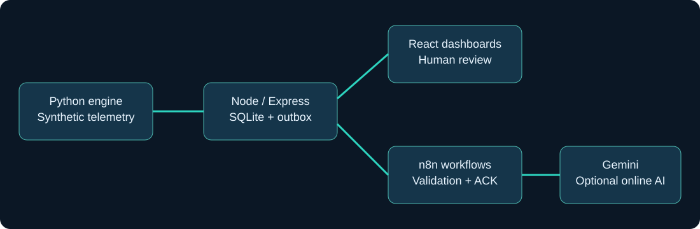
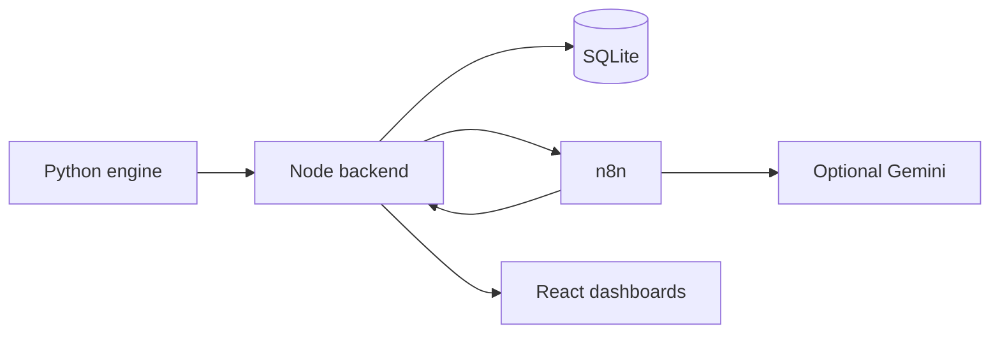

# Architecture

The engine serves local reports and event feeds. The active backend worker polls every five seconds, stores cursor and emission receipts, and calls local incident upsert. Initial bootstrap starts at the current last sequence, skipping historical events. Alert delivery retries pending rows every 30 seconds; acknowledgment checks accepted and event ID. Medical state is separate from physiological event state.

The standalone Node poller is not the active backend worker. The current local alert outbox is not a separate Earth receiver.
